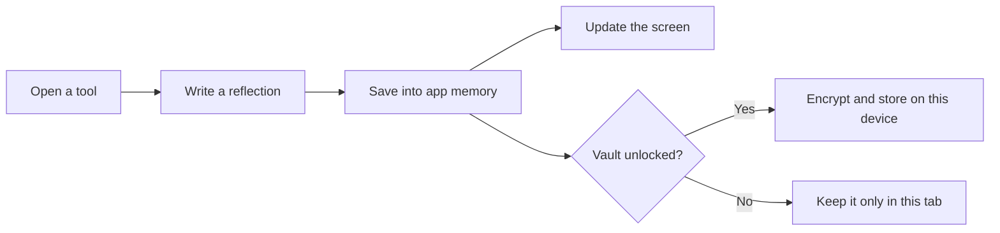

# The Sereinly handbook

**A friendly guide to using the app, understanding the code, and making your first change.**

You do not need to read the whole project to understand Sereinly. Start with the part that interests you, try one small change, and use the checks to see whether it works.

Sereinly is a browser app. Its screens, exercises, charts, and optional encrypted storage run on the user's device. There is currently no application server, account system, or cloud database.

## Find your starting point

| I want to… | Start here |
| --- | --- |
| Understand what people can do in the app | [A short tour](#a-short-tour) |
| Run the project on my computer | [Get it running](#get-it-running) |
| Know what each file does | [A map of the code](#a-map-of-the-code) |
| Understand how a click becomes a saved record | [Follow one interaction](#follow-one-interaction) |
| Understand privacy and storage | [Where personal information goes](#where-personal-information-goes) |
| Change words, colors, or library content | [Make a small change](#make-a-small-change) |
| Understand GitHub's automatic checks | [What GitHub Actions does](#what-github-actions-does) |
| Fix a setup or test problem | [When something goes wrong](#when-something-goes-wrong) |

## A short tour

The opening page offers a quiet minute, optional soft-rain sound, and a few ways into the self-help tools. Nothing starts playing automatically. A person can explore without signing up or answering a questionnaire.

The main navigation leads to four places:

| Place | What it offers |
| --- | --- |
| **Find your calm** | The opening page, gentle pause, and interactive support map. |
| **The toolkit** | Breathing, sensory grounding, thought reflections, small tasks, focus support, urge surfing, and other exercises. |
| **The quiet library** | Short educational notes with links to their sources. |
| **My space** | A personal overview, mood insights, journal, safety plan, and settings. |

The **I need support** button remains in the header. It opens grounding and safety-plan options alongside the available support information. This app is a self-help companion, not emergency care or a replacement for professional diagnosis and treatment.

Charts initially show clearly labeled sample records. Those examples help people explore the interface; they are not observations about the person using it. Personal records are separate.

## Get it running

Use **Node.js 24** and npm. Node.js runs the development tools; npm installs the libraries the app uses. The `.nvmrc` file tells compatible version managers which Node version this project recommends. Ordinary app visitors do not need either tool.

Open a terminal in the project folder and run:

```sh
npm ci
npm run dev
```

Open the local address printed in the terminal. Editing a source file normally updates the browser automatically. Stop the server with **Ctrl+C** when finished.

On Windows, if PowerShell blocks `npm.ps1`, use `npm.cmd` in place of `npm`:

```powershell
npm.cmd ci
npm.cmd run dev
```

`npm ci` installs the exact dependency versions recorded in `package-lock.json`. Keep that file with the project; it helps your computer and GitHub use the same libraries.

To inspect the production build:

```sh
npm run build
npm run preview
```

The build creates the `dist/` folder. Preview serves those finished files locally. Development and preview servers are local tools, not public deployments.

## A map of the code

Think of the app as a small building. React components are its rooms, styles are its appearance, and the data helpers look after its records.

| File or folder | Its job | Open it when… |
| --- | --- | --- |
| `index.html` | The browser's starting document, page title, description, and favicon link. | You want to change the browser-tab name or description. |
| `src/main.tsx` | Starts React and coordinates navigation, dialogs, personal records, settings, and the self-help modules. | You want to understand an exercise or personal-space behavior. |
| `src/Welcome.tsx` | Builds the arrival page, breathing flower, rain audio, support map, library, and reading dialogs. | You want to change the opening experience. |
| `src/SiteHeader.tsx` | Shows the brand, navigation, theme control, mobile menu, and support button. | You want to change how people move around. |
| `src/wellbeing.ts` | Holds library articles and the map's support paths as structured content. | You want to edit an article or map description. |
| `src/data.ts` | Defines record shapes and handles encryption, vault migration, CSV export, and a correlation calculation. | You want to understand saved information. |
| `src/style.css` | Styles the dashboard, tools, forms, dialogs, accessibility options, and printed pages. | You want to change an existing tool's appearance. |
| `src/welcome.css` | Styles the Sereinly header, opening page, library, and responsive layouts; also overrides some shared styles. | You want to adjust the newer visual design. |
| `public/favicon.svg` | The small leaf symbol used in the browser tab. | You want to update the favicon. |
| `src/data.test.ts` | Checks encryption, rejected passwords, tampered data, exports, and migration. | You change how records are handled. |
| `tests/experience.spec.ts` | Opens a real browser and checks important user journeys and automated accessibility rules. | You change interactions or navigation. |
| `package.json` | Lists the libraries and shortcuts such as `npm run build`. | You need a command or are adding a dependency. |
| `package-lock.json` | Records the exact resolved dependency versions. | You intentionally update dependencies; npm maintains this file. |
| `vite.config.ts` | Configures the development server and production bundling. | You need to change build behavior. |
| `tsconfig.json` | Configures TypeScript's checks for the app source. | You need to understand compiler behavior. |
| `vitest.config.ts` | Selects the small, code-level tests under `src/`. | You need to adjust unit-test discovery. |
| `playwright.config.ts` | Chooses the browser, starts a test server, and configures browser-test reports. | Browser tests need a different setup. |
| `scripts/` | Contains optional screenshot and accessibility-inspection utilities. | You want a visual record or a quick audit. |
| `.github/` | Holds GitHub's checks and dependency-update configuration. | You need to change automation. |

You will also see generated folders. `node_modules/` contains installed libraries, `dist/` contains the built site, and `playwright-report/` contains browser-test reports. Edit the source rather than these generated files. Git ignores them.

## Follow one interaction

Imagine someone opens a thought reflection, writes an answer, and saves it.

1. A button calls `open('thought')` in `src/main.tsx`.
2. The app sets its `modal` value to `thought` and resets temporary answers.
3. The dialog displays the thought-reflection wizard. Its inputs update `fields`, the temporary answer list.
4. Finishing calls `record(...)`. That adds a journal entry and a self-care seed to `data`.
5. React redraws the relevant parts of the screen.
6. If encrypted saving is enabled, a save effect encrypts the updated records and writes them to this browser's storage.



Some useful names you will encounter in the code:

| Name | Plain-language meaning |
| --- | --- |
| `page` | Which main screen is showing. Navigation uses React state rather than separate page URLs. |
| `modal` | Which tool or reading dialog is open. An empty string means none. |
| `data` | The current personal records and preferences. |
| `fields` | Answers for the currently open exercise; these are not a saved journal entry yet. |
| `update(...)` | Changes selected parts of `data`. |
| `record(...)` | Adds a reflection or practice to the journal. |
| `password` | The in-memory passphrase for an unlocked vault. It is not written to storage. |

Refreshing returns to the opening screen. It does not automatically unlock private records.

## Where personal information goes

### Before saving is enabled

Personal records live in the current tab's memory. Reloading or closing the tab loses session-only records. The personal-space toolbar and privacy settings explain this. A compact quiet minute on the homepage does not, by itself, create a journal entry; the dialog's finish action can record a moment.

### After a vault is created or unlocked

The app encrypts records before writing them to `localStorage`, the browser's small built-in storage area. They belong to that browser profile and site address; another browser, computer, or hosting address will not automatically have them.

The stored vault contains encrypted text and the random values needed to decrypt it with the correct passphrase. It does **not** contain the passphrase. The code uses the browser's Web Crypto API: AES-256-GCM for encryption and PBKDF2 to derive a key from the passphrase.

There is no account recovery or password reset service. Locking clears the app's visible personal state, but JavaScript cannot guarantee a secure wipe of all browser memory. Anyone using an unlocked tab can see its records.

Earlier versions used a different storage key. `readVault`, `writeVault`, and `eraseVault` preserve that compatibility. Migration removes the older record only after the new write succeeds. Keep that order when changing storage code.

### What the records look like

| Record | Contents |
| --- | --- |
| `Mood` | A date, mood, sleep hours, energy, anxiety, emotions, triggers, and medication-adherence selection. |
| `Entry` | A date, a kind of reflection or practice, and its text values. |
| `Data` | Mood and journal records, name and focus preferences, self-care seeds, completed actions, safety-plan fields, worries, and display settings. |

These types describe expected shapes for developers. They are not a clinical assessment or a complete validator for imported or externally supplied data.

### Exports are readable copies

CSV, printed/PDF summaries, and JSON exports are not encrypted vaults. Anyone with those files can read their contents. Use made-up data when sharing screenshots, bug reports, or test artifacts. The current interface exports a JSON copy but does not provide a JSON import screen.

The app has no cloud sync or analytics service configured. Clicking an external library-source link opens that provider's website; that is separate from local record saving.

## Make a small change

Start with a small edit and keep the app running beside your editor.

### Change a sentence

Search for the visible words in `src/Welcome.tsx` or `src/main.tsx`, then change the text inside the markup. For example, the homepage title comes from `Welcome` in `src/Welcome.tsx`.

Keep button labels close to what happens next: “Open breathing space” is easier to understand than “Transform your mind.” Avoid promising a clinical outcome.

### Change a color

Look for CSS variables such as `--bg`, `--surface`, `--ink`, and `--green` in the style files. They name shared background, panel, text, and accent colors.

Both style files load, with `welcome.css` after `style.css`. A later matching rule can override an earlier one. This explains why changing the first color you find may not change the screen you are looking at.

Check light mode, dark mode, mobile layout, and keyboard focus after a visual change. A soft color still needs readable contrast.

### Add a library note

The `articles` array in `src/wellbeing.ts` holds the notes. Each item has an ID, category, title, short description, paragraphs, source information, and an optional next exercise represented by a tool ID.

When adding one, use a unique `id`, include a reliable source link, and choose an existing tool ID for its action. The current library intentionally displays up to three matching notes on the homepage and four on the full library page. If you add more and want them all displayed, adjust the limit in `KnowledgeLibrary` in `src/Welcome.tsx`.

### Change where a map path leads

The `paths` array in `src/wellbeing.ts` supplies the map. Its `tool` must match a dialog ID recognized in `src/main.tsx`.

Some existing IDs are:

| ID | Opens |
| --- | --- |
| `pause` | The gentle quiet-minute experience. |
| `breathing` | The selectable breathing pacer. |
| `grounding` | The sensory grounding wizard. |
| `thought` | The thought-reflection wizard. |
| `spoons` | Energy-matched small tasks. |
| `focus` | Task breakdown and focus timer. |
| `urge` | The urge-surfing timer. |
| `worry` | Worry time and parked worries. |
| `body` | The emotion and body check. |
| `tipp` | Distress-tolerance options. |
| `dopamine` | The editable dopamine menu. |
| `gratitude` | A small-good-thing journal entry. |
| `note` | Free writing. |

Changing an ID in only one place can leave a button opening an empty dialog. Follow the ID from its button or content item to its dialog before renaming it.

### Change stored information

Start with the types in `src/data.ts`, then update the initial values, relevant input forms, saving behavior, and tests. Existing encrypted vaults may not contain a field you add today. Plan compatible defaults or an explicit migration before relying on that new field.

## Check your work

The project has different checks because different mistakes need different tools.

| Command | What it checks |
| --- | --- |
| `npm run typecheck` | Inconsistent TypeScript types and unused code in the app source. |
| `npm test` | Small code-level checks, especially privacy, exports, and migration. |
| `npm run build` | Whether TypeScript and Vite can produce the finished site. |
| `npm run test:e2e` | Real browser interactions, including vault use, mobile navigation, and homepage accessibility checks. |

Browser tests start their own server and stop it when finished. Locally they use installed Google Chrome and can reuse a development server already running at `http://127.0.0.1:5173`. You do not need to start a separate server just for these tests.

For an HTML summary after a browser-test run:

```sh
npx playwright show-report
```

Failures can also produce screenshots and traces in `test-results/`. A trace is a replayable record of the automated test's actions. The tests use fictional information and isolated browser contexts.

The standalone scripts `scripts/capture-ui.mjs` and `scripts/audit-accessibility.mjs` still need a running development server and installed Chrome. The first captures desktop and mobile images; the second prints accessibility findings. The test suite is the automation that fails when its accessibility assertions fail. An automated pass does not certify every screen or replace testing with assistive technologies.

## What GitHub Actions does

GitHub Actions runs commands on a temporary computer when a repository event happens. You can think of it as a second person checking the project from a clean setup.

| Configuration | When it runs | What it does |
| --- | --- | --- |
| `.github/workflows/ci.yml` — **App checks** | Pushes, pull requests, and manual starts. | Installs locked dependencies, checks types, runs unit tests, builds the app, and runs browser/accessibility tests. |
| `.github/workflows/dependency-audit.yml` — **Dependency audit** | Mondays at 05:23 UTC and manual starts. | Runs npm's vulnerability audit for application and development dependencies; high or critical findings fail the check. |
| `.github/dependabot.yml` | Weekly, once enabled in the GitHub repository. | Proposes npm and GitHub Actions updates as pull requests for review. It does not automatically merge them. |

The browser step in **App checks** uses Playwright's matching Chromium browser. It starts a preview of `dist/`, so it tests the production build rather than only the development server. CI also rejects accidentally committed `test.only` cases and retries a failed test once.

The run keeps two downloadable artifacts for seven days:

- **browser-test-reports:** the HTML report and any failure diagnostics.
- **sereinly-dist:** the production files, uploaded only after the preceding checks succeed.

A newer run replaces an older in-progress run for the same pull request or branch. The workflows have read-only repository permissions and do not need application secrets. They do not publish the site.

### Start using the workflows

Add the project to a GitHub repository and push these files, including the hidden `.github/` folder, `.nvmrc`, and `package-lock.json`. In the repository's **Actions** tab, look for **App checks**. If Actions is disabled, a repository administrator will need to enable it.

To start a check yourself, select its workflow in the Actions tab and choose **Run workflow** after the workflow file exists on the default branch. Scheduled audit runs also require the file on the default branch. GitHub may delay scheduled runs; they are not exact-time alarms.

This workspace can validate the workflow's commands locally, but a GitHub-hosted run happens only after the files are pushed to a GitHub repository.

### Read a failed check

Open the failed run, select its job, and expand the first failed step. A type error points to a source file; a browser failure points to a test and may include a screenshot or trace. Fix the cause, run the relevant local check, and push the change.

An audit failure means the registry reports a dependency issue. Review the affected package and update deliberately; a forced audit fix can introduce breaking changes. Re-run the app checks after dependency updates.

## When something goes wrong

| What you see | What to try |
| --- | --- |
| PowerShell says `npm.ps1` cannot be loaded. | Use `npm.cmd` instead. No PowerShell policy change is needed. |
| npm reports an unsupported Node version. | Use Node 24. The exact accepted range is recorded in `package.json`. |
| `npm ci` says the package files disagree. | If you intentionally changed dependencies, run `npm install`, then include both package files in the change. Otherwise restore the matching lockfile. |
| A local browser test cannot find Chrome. | Install Google Chrome, or run `npx playwright install chrome`, then retry. This installation may need operating-system permission. |
| Port 5173 is busy. | Stop an old development or preview server. CI deliberately refuses to reuse an existing server. |
| The CI preview cannot find the production files. | Run `npm run build` before CI-mode browser tests. The supplied workflow already does this. |
| Records disappear after a reload. | Check whether they were session-only. If a vault exists, unlock it in Settings. |
| A vault will not unlock. | Check the passphrase and that you are using the same browser profile and site address. There is no recovery service. |
| A style edit has no visible effect. | Check whether a later rule in `welcome.css` overrides it, or whether the current screen uses a different class. |
| A GitHub workflow has not appeared. | Confirm `.github/workflows/` was pushed to the repository and Actions is enabled. This project folder itself does not create a remote repository. |

## A few words you will see

| Word | Meaning here |
| --- | --- |
| React | The library that assembles the interface from reusable pieces called components. |
| TypeScript | JavaScript with extra checks that help catch mistakes before the app runs. |
| State | Values the app remembers while it is open, such as the selected screen or current answers. |
| Component | A function describing a piece of the interface. |
| Vite | The tool that serves the app during development and packages it for production. |
| Dependency | Another library that this project uses. |
| Unit test | A focused check of a small part of the code. |
| End-to-end test | A browser following a user journey, such as writing and saving a journal entry. |
| CI | Continuous integration: automatic checks when code changes. |
| Artifact | A file or folder saved by an automation run for later download. |
| Local-first | Personal records stay on the user's device in the current implementation. |

For the complete privacy and product limits, see [README.md](README.md). For the automation conventions used here, see the official [GitHub setup-node documentation](https://github.com/actions/setup-node), [Playwright CI guide](https://playwright.dev/docs/ci), and [Playwright test-server guide](https://playwright.dev/docs/test-webserver).
