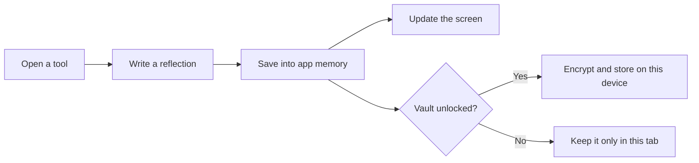

# The Sereinly handbook

**A friendly guide to using the app, understanding the code, and making your first change.**

You do not need to read the whole project to understand Sereinly. Start with the part that interests you, try one small change, and use the checks to see whether it works.

Sereinly is a browser app. Its screens, exercises, charts, and optional encrypted storage run on the user's device. There is currently no application server, account system, or cloud database.

## Find your starting point

| I want to… | Start here |
| --- | --- |
| Understand what people can do in the app | [A short tour](#a-short-tour) |
| Deploy the app to Vercel | [Deployment README](README.md#deploy-to-vercel) |
| Run the project on my computer (optional) | [Local development README](README.local.md) |
| Know what each file does | [A map of the code](#a-map-of-the-code) |
| Understand how a click becomes a saved record | [Follow one interaction](#follow-one-interaction) |
| Understand privacy and storage | [Where personal information goes](#where-personal-information-goes) |
| Change words, colors, or library content | [Make a small change](#make-a-small-change) |
| Understand GitHub's automatic checks | [What GitHub Actions does](#what-github-actions-does) |
| Fix an installation or local test problem | [Local troubleshooting](README.local.md#local-troubleshooting) |

## A short tour

The opening page offers a quiet minute, optional soft-rain sound, and a few ways into the self-help tools. Nothing starts playing automatically. A person can explore without signing up or answering a questionnaire.

The main navigation leads to four places:

| Place | What it offers |
| --- | --- |
| **Find your calm** | The opening page, gentle pause, and interactive support map. |
| **The toolkit** | Breathing, sensory grounding, thought reflections, small tasks, focus support, urge surfing, and other exercises. |
| **The quiet library** | Short educational notes with links to their sources. |
| **My space** | A personal overview, mood insights, journal, safety plan, and settings. |

The **I need support** button remains in the header. It opens grounding and safety-plan options alongside the available support information. This app is a self-help companion, not emergency care or a replacement for professional diagnosis and treatment.

Charts initially show clearly labeled sample records. Those examples help people explore the interface; they are not observations about the person using it. Personal records are separate.

## Deploy or develop

Follow the [main README](README.md#deploy-to-vercel) to deploy through Vercel in your browser. If you prefer to work on your computer, installation, local previews, and testing instructions live in the [optional local development README](README.local.md).

## A map of the code

Think of the app as a small building. React components are its rooms, styles are its appearance, and the data helpers look after its records.

| File or folder | Its job | Open it when… |
| --- | --- | --- |
| `README.md` | Guides deployment through the Vercel website. | You want to publish or update the hosted app. |
| `README.local.md` | Holds optional installation, preview, and testing instructions. | You want to work on your own computer. |
| `index.html` | The browser's starting document, page title, description, and favicon link. | You want to change the browser-tab name or description. |
| `src/main.tsx` | Starts React and coordinates navigation, dialogs, personal records, settings, and the self-help modules. | You want to understand an exercise or personal-space behavior. |
| `src/Welcome.tsx` | Builds the arrival page, breathing flower, rain audio, support map, library, and reading dialogs. | You want to change the opening experience. |
| `src/SiteHeader.tsx` | Shows the brand, navigation, theme control, mobile menu, and support button. | You want to change how people move around. |
| `src/wellbeing.ts` | Holds library articles and the map's support paths as structured content. | You want to edit an article or map description. |
| `src/data.ts` | Defines record shapes and handles encryption, vault migration, CSV export, and a correlation calculation. | You want to understand saved information. |
| `src/style.css` | Styles the dashboard, tools, forms, dialogs, accessibility options, and printed pages. | You want to change an existing tool's appearance. |
| `src/welcome.css` | Styles the Sereinly header, opening page, library, and responsive layouts; also overrides some shared styles. | You want to adjust the newer visual design. |
| `public/favicon.svg` | The small leaf symbol used in the browser tab. | You want to update the favicon. |
| `src/data.test.ts` | Checks encryption, rejected passwords, tampered data, exports, and migration. | You change how records are handled. |
| `tests/experience.spec.ts` | Opens a real browser and checks important user journeys and automated accessibility rules. | You change interactions or navigation. |
| `package.json` | Lists the libraries and shortcuts such as `npm run build`. | You need a command or are adding a dependency. |
| `package-lock.json` | Records the exact resolved dependency versions. | You intentionally update dependencies; npm maintains this file. |
| `vite.config.ts` | Configures the development server and production bundling. | You need to change build behavior. |
| `tsconfig.json` | Configures TypeScript's checks for the app source. | You need to understand compiler behavior. |
| `vitest.config.ts` | Selects the small, code-level tests under `src/`. | You need to adjust unit-test discovery. |
| `playwright.config.ts` | Chooses the browser, starts a test server, and configures browser-test reports. | Browser tests need a different setup. |
| `scripts/` | Contains optional screenshot and accessibility-inspection utilities. | You want a visual record or a quick audit. |
| `.github/` | Holds GitHub's checks and dependency-update configuration. | You need to change automation. |

You will also see generated folders. `node_modules/` contains installed libraries, `dist/` contains the built site, and `playwright-report/` contains browser-test reports. Edit the source rather than these generated files. Git ignores them.

## Follow one interaction

Imagine someone opens a thought reflection, writes an answer, and saves it.

1. A button calls `open('thought')` in `src/main.tsx`.
2. The app sets its `modal` value to `thought` and resets temporary answers.
3. The dialog displays the thought-reflection wizard. Its inputs update `fields`, the temporary answer list.
4. Finishing calls `record(...)`. That adds a journal entry and a self-care seed to `data`.
5. React redraws the relevant parts of the screen.
6. If encrypted saving is enabled, a save effect encrypts the updated records and writes them to this browser's storage.

Some useful names you will encounter in the code:

| Name | Plain-language meaning |
| --- | --- |
| `page` | Which main screen is showing. Navigation uses React state rather than separate page URLs. |
| `modal` | Which tool or reading dialog is open. An empty string means none. |
| `data` | The current personal records and preferences. |
| `fields` | Answers for the currently open exercise; these are not a saved journal entry yet. |
| `update(...)` | Changes selected parts of `data`. |
| `record(...)` | Adds a reflection or practice to the journal. |
| `password` | The in-memory passphrase for an unlocked vault. It is not written to storage. |

Refreshing returns to the opening screen. It does not automatically unlock private records.

## Where personal information goes

### Before saving is enabled

Personal records live in the current tab's memory. Reloading or closing the tab loses session-only records. The personal-space toolbar and privacy settings explain this. A compact quiet minute on the homepage does not, by itself, create a journal entry; the dialog's finish action can record a moment.

### After a vault is created or unlocked

The app encrypts records before writing them to `localStorage`, the browser's small built-in storage area. They belong to that browser profile and site address; another browser, computer, or hosting address will not automatically have them.

The stored vault contains encrypted text and the random values needed to decrypt it with the correct passphrase. It does **not** contain the passphrase. The code uses the browser's Web Crypto API: AES-256-GCM for encryption and PBKDF2 to derive a key from the passphrase.

There is no account recovery or password reset service. Locking clears the app's visible personal state, but JavaScript cannot guarantee a secure wipe of all browser memory. Anyone using an unlocked tab can see its records.

Earlier versions used a different storage key. `readVault`, `writeVault`, and `eraseVault` preserve that compatibility. Migration removes the older record only after the new write succeeds. Keep that order when changing storage code.

### What the records look like

| Record | Contents |
| --- | --- |
| `Mood` | A date, mood, sleep hours, energy, anxiety, emotions, triggers, and medication-adherence selection. |
| `Entry` | A date, a kind of reflection or practice, and its text values. |
| `Data` | Mood and journal records, name and focus preferences, self-care seeds, completed actions, safety-plan fields, worries, and display settings. |

These types describe expected shapes for developers. They are not a clinical assessment or a complete validator for imported or externally supplied data.

### Exports are readable copies

CSV, printed/PDF summaries, and JSON exports are not encrypted vaults. Anyone with those files can read their contents. Use made-up data when sharing screenshots, bug reports, or test artifacts. The current interface exports a JSON copy but does not provide a JSON import screen.

The app has no cloud sync or analytics service configured. Clicking an external library-source link opens that provider's website; that is separate from local record saving.

## Make a small change

Start with a small edit and keep the app running beside your editor.

### Change a sentence

Search for the visible words in `src/Welcome.tsx` or `src/main.tsx`, then change the text inside the markup. For example, the homepage title comes from `Welcome` in `src/Welcome.tsx`.

Keep button labels close to what happens next: “Open breathing space” is easier to understand than “Transform your mind.” Avoid promising a clinical outcome.

### Change a color

Look for CSS variables such as `--bg`, `--surface`, `--ink`, and `--green` in the style files. They name shared background, panel, text, and accent colors.

Both style files load, with `welcome.css` after `style.css`. A later matching rule can override an earlier one. This explains why changing the first color you find may not change the screen you are looking at.

Check light mode, dark mode, mobile layout, and keyboard focus after a visual change. A soft color still needs readable contrast.

### Add a library note

The `articles` array in `src/wellbeing.ts` holds the notes. Each item has an ID, category, title, short description, paragraphs, source information, and an optional next exercise represented by a tool ID.

When adding one, use a unique `id`, include a reliable source link, and choose an existing tool ID for its action. The current library intentionally displays up to three matching notes on the homepage and four on the full library page. If you add more and want them all displayed, adjust the limit in `KnowledgeLibrary` in `src/Welcome.tsx`.

### Change where a map path leads

The `paths` array in `src/wellbeing.ts` supplies the map. Its `tool` must match a dialog ID recognized in `src/main.tsx`.

Some existing IDs are:

| ID | Opens |
| --- | --- |
| `pause` | The gentle quiet-minute experience. |
| `breathing` | The selectable breathing pacer. |
| `grounding` | The sensory grounding wizard. |
| `thought` | The thought-reflection wizard. |
| `spoons` | Energy-matched small tasks. |
| `focus` | Task breakdown and focus timer. |
| `urge` | The urge-surfing timer. |
| `worry` | Worry time and parked worries. |
| `body` | The emotion and body check. |
| `tipp` | Distress-tolerance options. |
| `dopamine` | The editable dopamine menu. |
| `gratitude` | A small-good-thing journal entry. |
| `note` | Free writing. |

Changing an ID in only one place can leave a button opening an empty dialog. Follow the ID from its button or content item to its dialog before renaming it.

### Change stored information

Start with the types in `src/data.ts`, then update the initial values, relevant input forms, saving behavior, and tests. Existing encrypted vaults may not contain a field you add today. Plan compatible defaults or an explicit migration before relying on that new field.

## Check your work

GitHub Actions runs type checks, unit tests, a production build, browser journeys, and automated homepage accessibility checks when code changes are pushed. Read the run in the repository’s Actions tab. An automated pass does not certify every screen or replace testing with assistive technologies.

For commands to run these checks on your computer, view the [optional testing guide](README.local.md#check-your-work).

## What GitHub Actions does

GitHub Actions runs commands on a temporary computer when a repository event happens. You can think of it as a second person checking the project from a clean setup.

| Configuration | When it runs | What it does |
| --- | --- | --- |
| `.github/workflows/ci.yml` — **App checks** | Pushes, pull requests, and manual starts. | Installs locked dependencies, checks types, runs unit tests, builds the app, and runs browser/accessibility tests. |
| `.github/workflows/dependency-audit.yml` — **Dependency audit** | Mondays at 05:23 UTC and manual starts. | Runs npm's vulnerability audit for application and development dependencies; high or critical findings fail the check. |
| `.github/dependabot.yml` | Weekly, once enabled in the GitHub repository. | Proposes npm and GitHub Actions updates as pull requests for review. It does not automatically merge them. |

The browser step in **App checks** uses Playwright's matching Chromium browser. It starts a preview of `dist/`, so it tests the production build rather than only the development server. CI also rejects accidentally committed `test.only` cases and retries a failed test once.

The run keeps two downloadable artifacts for seven days:

- **browser-test-reports:** the HTML report and any failure diagnostics.
- **sereinly-dist:** the production files, uploaded only after the preceding checks succeed.

A newer run replaces an older in-progress run for the same pull request or branch. The workflows have read-only repository permissions and do not need application secrets. They do not publish the site.

### Start using the workflows

Add the project to a GitHub repository and push these files, including the hidden `.github/` folder, `.nvmrc`, and `package-lock.json`. In the repository's **Actions** tab, look for **App checks**. If Actions is disabled, a repository administrator will need to enable it.

To start a check yourself, select its workflow in the Actions tab and choose **Run workflow** after the workflow file exists on the default branch. Scheduled audit runs also require the file on the default branch. GitHub may delay scheduled runs; they are not exact-time alarms.

This workspace can validate the workflow's commands locally, but a GitHub-hosted run happens only after the files are pushed to a GitHub repository.

### Read a failed check

Open the failed run, select its job, and expand the first failed step. A type error points to a source file; a browser failure points to a test and may include a screenshot or trace. Fix the cause, run the relevant local check, and push the change.

An audit failure means the registry reports a dependency issue. Review the affected package and update deliberately; a forced audit fix can introduce breaking changes. Re-run the app checks after dependency updates.

## When something goes wrong

| What you see | What to try |
| --- | --- |
| Records disappear after a reload. | Check whether they were session-only. If a vault exists, unlock it in Settings. |
| A vault will not unlock. | Check the passphrase and that you are using the same browser profile and site address. There is no recovery service. |
| A style edit has no visible effect. | Check whether a later rule in `welcome.css` overrides it, or whether the current screen uses a different class. |
| A GitHub workflow has not appeared. | Confirm `.github/workflows/` was pushed to the repository and Actions is enabled. This project folder itself does not create a remote repository. |

Installation, browser setup, and local-server problems are covered in [local troubleshooting](README.local.md#local-troubleshooting).

## A few words you will see

| Word | Meaning here |
| --- | --- |
| React | The library that assembles the interface from reusable pieces called components. |
| TypeScript | JavaScript with extra checks that help catch mistakes before the app runs. |
| State | Values the app remembers while it is open, such as the selected screen or current answers. |
| Component | A function describing a piece of the interface. |
| Vite | The tool that serves the app during development and packages it for production. |
| Dependency | Another library that this project uses. |
| Unit test | A focused check of a small part of the code. |
| End-to-end test | A browser following a user journey, such as writing and saving a journal entry. |
| CI | Continuous integration: automatic checks when code changes. |
| Artifact | A file or folder saved by an automation run for later download. |
| Local-first | Personal records stay on the user's device in the current implementation. |

For deployment steps, see [README.md](README.md). For privacy and product limits, continue to the product notes below. For the automation conventions used here, see the official [GitHub setup-node documentation](https://github.com/actions/setup-node), [Playwright CI guide](https://playwright.dev/docs/ci), and [Playwright test-server guide](https://playwright.dev/docs/test-webserver).

## Product notes and current limits

### Data schema and persistence

`Data` contains name, nonclinical focus preferences, mood records, journal records, self-care seeds, completed actions, seven safety-plan fields, parked worries, worry schedule, and accessibility preferences. `Mood` stores ISO date, mood (1–10), energy (1–10), anxiety (0–10), sleep hours (0–24), emotions, triggers, and medication adherence. `Entry` stores ISO date, kind, and ordered reflection values. See `src/data.ts` for the complete schema.

Data stays in memory until a user enables saving. The `sereinly-v1` localStorage record is a versioned envelope containing base64 salt, IV, and ciphertext. AES-256-GCM authenticates ciphertext, PBKDF2-SHA256 derives the key with 310,000 iterations, and each save uses a fresh random 16-byte salt and 12-byte IV. No password or key is persisted. There is no recovery. Use HTTPS or localhost for Web Crypto. No third-party analytics, remote assets, cloud database, or authentication service is configured. Locking removes visible session data; browser memory cannot be securely wiped by JavaScript. An unlocked device or malicious scripts can access decrypted data. Exports intentionally contain plaintext and must be handled carefully.

Existing vaults from the previous app name remain readable. On successful unlock, data is encrypted and written under the Sereinly storage key before the legacy record is removed. A failed write leaves the legacy vault intact. The previous name remains only in the migration code and tests, not the user interface. Downloads, package metadata, document title, favicon, privacy copy and printed content use Sereinly.

### Design and naming research

The reference at https://mindheaven.life/ was inspected on 17 October 2026. The redesign adapts its spacious typography, interactive network exploration and knowledge-library concept to a self-help context. The support map opens actual exercises; library notes are original summaries that link to NHS guidance. It does not invent researchers, affiliations, AI capabilities, clinical outcomes or supplement claims.

The new name is **Sereinly**. Exact-name and app/brand web searches on 17 October 2026 found no obvious existing exact-name app or brand. Search visibility does not establish legal uniqueness; trademark and domain availability have not been verified.

The opening experience offers a quiet minute without an account or a mandatory check-in. Breathing visuals only animate after an explicit start. Sound is off by default and synthesized in the browser without downloads. Reduced-motion preferences disable the bloom animation while keeping text guidance available. The user can pause, leave, switch to sensory grounding, or open support at any time. This is designed to reduce pressure; immediate relief is not promised.

Sample mood data is separate from personal records; sample data is never exported as personal data. An example CBT record is available from the empty journal. The body map and emotion choices work without stored data. Browser Print / Save PDF exports the personal summary and CBT records; CSV exports personal mood records. Cloud sync is optional in the brief and is not implemented. No API secrets are needed.

### Clinical and product boundaries

The task breakdown is an editable rule-based guide, not an AI service. Worry time is a user-controlled compartment with a daily time setting, not an access lock or background notification. Focus and urge timers run while the tab is active; browsers may throttle background timers. Haptics depend on browser support. The emotion map is an emotion-selection aid, not a diagnostic assessment. TIPP uses gentler alternatives and explicit skip choices; it does not prescribe intense exercise or extreme cold. No app behavior diagnoses bipolar disorder, predicts risk, or changes medication. Sereinly is not emergency care.

The crisis panel uses an explicit country choice, defaults to India based on the requested locale, and does not request geolocation. Tele-MANAS was verified through the supplied hotline service on 17 October 2026. Other countries currently receive local emergency/provider guidance rather than unverified telephone numbers.

Clinical references used for cautious breathing instructions and safety-plan structure:
- NHS breathing guidance: https://www.nhs.uk/mental-health/self-help/guides-tools-and-activities/breathing-exercises-for-stress/
- VA safety plan: https://www.ptsd.va.gov/appvid/mobile/safety_plan_app.asp

Before a public healthcare launch, obtain clinical content review, an independent security review, accessibility testing with assistive technologies, and jurisdiction-specific privacy/legal review. The arrival page passes automated axe WCAG A/AA checks in light and dark themes; this does not certify the entire application or replace manual assistive-technology testing. Production healthcare readiness has not been certified.
